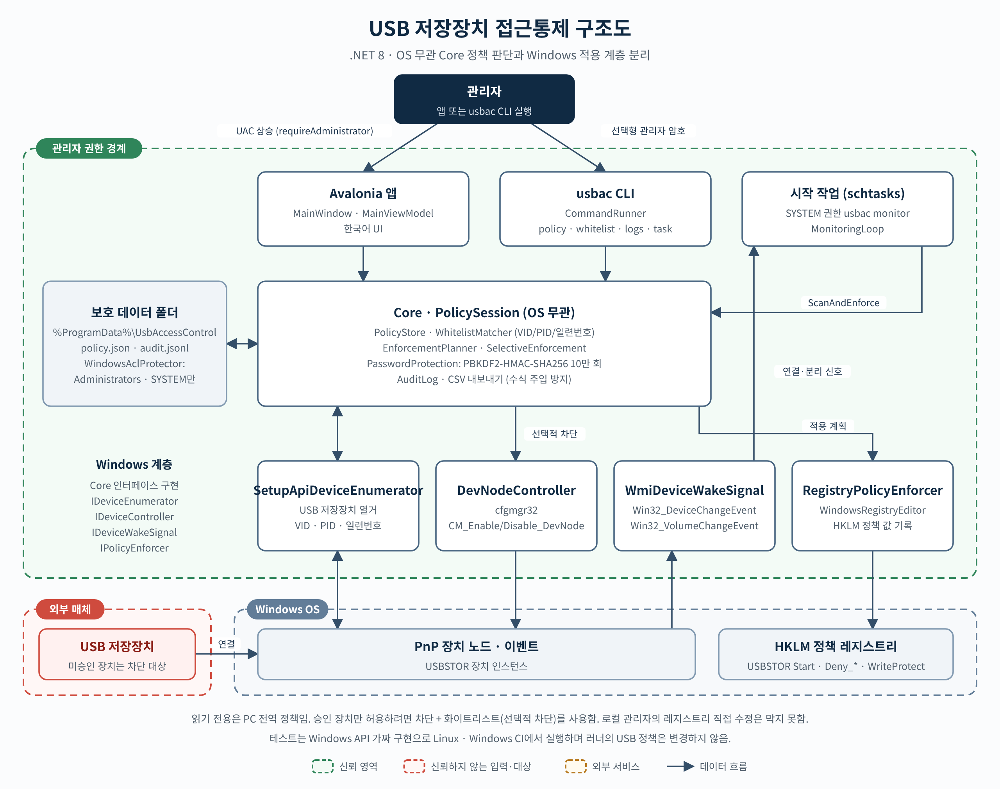
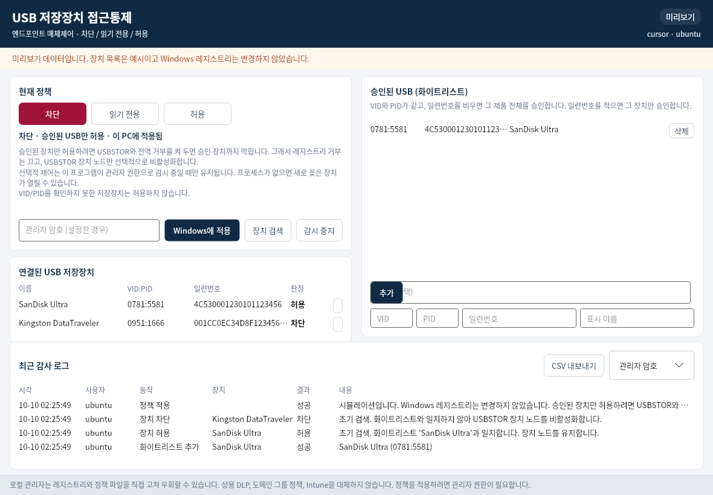

# USB 저장장치 접근통제

[](https://github.com/kh20134/usb-access-control/actions/workflows/ci.yml)

Windows 10/11 PC에서 USB 대용량 저장장치 접근을 **차단**, **읽기 전용**, **허용**으로 두는 작은 오픈소스 엔드포인트 도구입니다. 공공·기업 환경에서 쓰는 매체제어 제품의 정책 모델을 로컬 PC에서 직접 확인해 볼 수 있게 만들었습니다.

저장소 소유자는 정보관리기술사 **최규선**입니다. 라이선스 고지의 저작권 표기는 `LICENSE`의 kh20134를 따릅니다.

이 프로그램은 상용 DLP, 도메인 그룹 정책, Intune을 대체하지 않습니다. 로컬 관리자는 레지스트리와 정책 파일을 직접 고쳐 우회할 수 있습니다.

## 개요

관리자가 한 대 또는 소수의 Windows PC에서 USB 저장장치 정책을 파일로 저장하고, 문서화된 Windows 정책 레지스트리와 장치 노드 제어로 적용합니다. 정책 판단, 화이트리스트 대조, 감사 로그, CSV 내보내기는 Windows API 없이 동작하므로 Linux에서도 단위 테스트를 돌릴 수 있습니다. 레지스트리와 장치 노드를 실제로 바꾸는 코드는 Windows에서 관리자 권한으로 실행할 때만 호출됩니다.

구성은 네 층입니다.

- **Core**: 정책, 화이트리스트, 적용 계획, 감사 로그
- **Windows**: USBSTOR·이동식 저장장치 레지스트리, SetupAPI 열거, cfgmgr32 장치 노드, WMI 이벤트
- **CLI (`usbac`)**: 스크립트와 작업 스케줄러용 명령
- **앱**: 한국어 Avalonia 창. CLI와 같은 정책 파일을 사용합니다



벡터 원본은 [docs/architecture.svg](docs/architecture.svg)입니다. 글자를 윤곽선으로 바꿔 두어 한글 폰트가 없는 환경에서도 같은 모양으로 보입니다.

## 주요 기능

- 정책 모드: **차단**, **읽기 전용**, **허용**
- VID/PID/일련번호 화이트리스트. 일련번호를 비우면 그 제품 전체를 승인합니다
- USB 저장장치 연결과 분리를 감시하고 장치 정보를 기록합니다
- 감사 로그를 JSON Lines로 저장하고 CSV로 내보냅니다. CSV는 UTF-8 BOM이며, `=`, `+`, `-`, `@`로 시작하는 칸은 수식 실행을 피하도록 따옴표를 붙입니다
- 정책 변경은 관리자 권한이 필요합니다. 관리자 암호를 설정하면 변경과 적용에 암호가 추가로 필요합니다. 암호는 PBKDF2-HMAC-SHA256(10만 회) 해시로만 저장됩니다
- Windows에서는 정책 폴더 ACL을 Administrators와 SYSTEM만 접근하게 잠급니다
- 한국어 UI와 CLI

## 화면

아래 그림은 실제 Avalonia 창을 헤드리스 렌더러로 캡처한 미리보기입니다. 장치 두 대(SanDisk Ultra, Kingston DataTraveler)와 오른쪽 위의 `예시PC · 사용자`는 `--preview`와 같은 **예시 데이터**이고, 캡처 중 Windows 레지스트리는 변경하지 않았습니다. Windows에서 실행하면 같은 화면에 그 PC의 계정, 실제 장치, 적용 상태가 나옵니다.



## 설치·빌드 방법

필요 조건은 [.NET 8 SDK](https://dotnet.microsoft.com/download/dotnet/8.0)입니다. 창과 CLI를 다른 PC에서 프레임워크 의존 방식으로 실행하려면 그 PC에 .NET 8 데스크톱 런타임이 있어야 합니다.

```bash
dotnet test UsbAccessControl.sln -c Release
dotnet build UsbAccessControl.sln -c Release
```

개발 중 실행:

```bash
dotnet run --project src/UsbAccessControl.Cli -- policy show
dotnet run --project src/UsbAccessControl.App
```

Windows에 배포할 출력:

```powershell
dotnet publish src/UsbAccessControl.App -c Release -r win-x64 --self-contained false -o artifacts/app
dotnet publish src/UsbAccessControl.Cli -c Release -r win-x64 --self-contained false -o artifacts/cli
```

`UsbAccessControl.exe`와 `usbac.exe` 매니페스트는 관리자 권한을 요청합니다. 탐색기에서 실행하면 UAC 동의 창이 뜹니다.

예시 데이터로 창만 보려면 `UsbAccessControl.exe --preview`를 사용합니다. 이 모드는 레지스트리를 쓰지 않습니다.

## 사용법

정책 파일의 기본 위치는 Windows에서 `%ProgramData%\UsbAccessControl`입니다. 그 안의 파일은 다음과 같습니다.

| 파일 | 내용 |
| --- | --- |
| `policy.json` | 모드, 화이트리스트, 암호 해시, 마지막 적용 지문 |
| `audit.jsonl` | 감사 로그. 한 줄에 JSON 하나 |
| `enforcement-state.json` | 이 프로그램이 꺼 둔 USBSTOR 장치 노드 |

다른 폴더를 쓰려면 `--data-dir`을 줍니다. 창과 CLI는 같은 폴더를 보면 같은 정책을 다룹니다.

모드를 저장하는 것과 Windows에 적용하는 것은 구분됩니다. `policy set`과 화이트리스트 편집은 원하는 상태를 파일에 저장합니다. `policy apply` 또는 창의 **Windows에 적용**이 레지스트리와 장치 노드를 바꿉니다. 차단을 적용할 때는 CLI에 `--yes`가 필요하고, 창에서는 적용 버튼을 한 번 더 눌러야 합니다.

```text
usbac policy show
usbac policy set readonly
usbac policy set block
usbac policy apply --yes

usbac whitelist add --vid 0781 --pid 5581 --serial 4C530001230101123456 --name "SanDisk Ultra" --note "총무팀 승인"
usbac whitelist list
usbac whitelist remove --id <guid>

usbac devices
usbac logs --limit 20
usbac logs export --out audit.csv

usbac password set --new "변경용-암호"
usbac password clear

usbac monitor
usbac task install
usbac task uninstall
```

관리자 암호가 있으면 `--password` 또는 환경 변수 `USBAC_ADMIN_PASSWORD`를 사용합니다. 프로세스 목록에 암호가 보이지 않게 하려면 환경 변수를 쓰십시오. 둘 다 없으면 터미널에서 입력을 숨긴 채 묻습니다.

`usbac task install`은 작업 스케줄러에 `UsbAccessControlMonitor` 작업을 등록합니다. 로그온이 아니라 시스템 시작 때 SYSTEM 권한으로 `usbac.exe monitor`를 실행합니다. 승인 장치만 허용하는 선택적 차단은 이 프로세스가 떠 있어야 유지됩니다.

종료 코드는 0 성공, 2 암호 거부, 3 사용법 또는 차단 확인 누락, 4 권한·운영 체제, 1 그 외 실패입니다. `policy show --json`과 `whitelist list --json`은 암호 해시를 출력하지 않습니다.

창에서는 연결된 장치의 **승인 목록에 넣기**로 VID, PID, 일련번호, 이름을 입력칸에 채울 수 있습니다. Windows에서는 창이 열리면 2초 간격 감시를 시작합니다.

## 정책 설명

화이트리스트와 맞지 않는 장치는 기본 정책을 따릅니다. 맞는 장치의 의도된 접근은 허용입니다. Windows가 그 의도를 그대로 적용할 수 있는지는 모드마다 다릅니다.

| 모드 | 화이트리스트 | 실제 적용 |
| --- | --- | --- |
| 허용 | 있음/없음 | USBSTOR를 수동 시작(3)으로 두고 거부 값과 WriteProtect를 0으로 둡니다. 화이트리스트는 접근을 더 제한하지 않습니다 |
| 읽기 전용 | 있음/없음 | 이동식 디스크는 읽을 수 있고 쓰기는 거부됩니다. 쓰기 금지는 PC 전역이라 승인 장치도 쓸 수 없습니다 |
| 차단 | 없음 | USBSTOR를 사용 안 함(4)으로 두고 이동식 저장 클래스 전체(`Deny_All`)와 이동식 디스크 읽기/쓰기를 거부합니다 |
| 차단 | 있음 | 전역 거부를 켜면 승인 장치까지 막히므로 레지스트리 거부는 끕니다. 일치하지 않는 USBSTOR 장치 노드만 비활성화합니다. VID/PID를 읽지 못한 저장장치는 허용하지 않습니다 |

적용하는 레지스트리 값은 모두 `HKLM`이고, 64비트 보기로 엽니다. 그룹 정책 "이동식 저장소 액세스"가 쓰는 값과 같습니다. 참고 문서는 [Policy CSP - ADMX_RemovableStorage](https://learn.microsoft.com/en-us/windows/client-management/mdm/policy-csp-admx-removablestorage)와 [이동식 장치 그룹 정책 문제 해결](https://learn.microsoft.com/en-us/troubleshoot/windows-server/group-policy/removable-devices-group-policy-troubleshooting-guidance)입니다.

| 키 | 값 | 의미 |
| --- | --- | --- |
| `SYSTEM\CurrentControlSet\Services\USBSTOR` | `Start` | 3 수동 시작, 4 사용 안 함. 키가 없으면 아무것도 쓰지 않고 중단합니다 |
| `SYSTEM\CurrentControlSet\Control\StorageDevicePolicies` | `WriteProtect` | 1이면 쓰기 금지. 읽기 전용의 보조 수단입니다 |
| `SOFTWARE\Policies\Microsoft\Windows\RemovableStorageDevices` | `Deny_All` | 1이면 모든 이동식 저장 클래스를 거부합니다. 개별 설정보다 우선합니다 |
| `SOFTWARE\Policies\Microsoft\Windows\RemovableStorageDevices\{53f5630d-b6bf-11d0-94f2-00a0c91efb8b}` | `Deny_Read`, `Deny_Write` | 이동식 디스크 클래스. 그룹 정책의 "Removable Disks: Deny read/write access"와 같은 값입니다 |

선택적 차단은 레지스트리만으로 일련번호 예외를 만들 수 없어서, 다음 Windows API를 사용합니다.

- 열거: SetupAPI `SetupDiGetClassDevs`. 디스크 클래스 `{4d36e967-e325-11ce-bfc1-08002be10318}`, 열거자 `USBSTOR`
- VID/PID: 장치 인스턴스 ID 또는 부모 노드의 `USB\VID_xxxx&PID_yyyy`
- 켜기/끄기: cfgmgr32 `CM_Enable_DevNode`, `CM_Disable_DevNode`
- 감시 깨우기: WMI `Win32_DeviceChangeEvent`, `Win32_VolumeChangeEvent`. 구독에 실패하면 2초 주기 검색만 계속합니다

장치 노드를 끄는 경로는 인스턴스 ID가 `USBSTOR\`로 시작할 때만 호출됩니다. 키보드, 마우스, 프린터처럼 USBSTOR가 아닌 장치는 끄지 않습니다.

일련번호 비교는 대소문자를 구분하지 않습니다. Windows가 USBSTOR 인스턴스 끝에 붙이는 `&0`, `&1` 같은 접미사는 비교 전에 뺍니다. 같은 VID/PID에 일련번호가 있는 항목과 없는 항목이 같이 있으면 일련번호가 맞는 항목이 우선합니다.

## 한계와 주의사항

- **로컬 관리자 우회.** 관리자는 레지스트리, 장치 관리자, 정책 파일을 직접 바꿀 수 있습니다. 관리자 암호는 이 프로그램의 변경 버튼에 대한 추가 문이며, 운영 체제 권한을 대신하지 않습니다. ACL도 관리자 앞에서는 경계가 아닙니다
- **상용 DLP가 아닙니다.** 파일 시스템 필터 드라이버가 없습니다. 프로세스 강제 종료, 서비스 시작 값 복구, 이미 열린 핸들로의 쓰기를 막지 못합니다
- **그룹 정책과 경합합니다.** 도메인 GPO가 같은 키를 관리하면 `gpupdate` 뒤 로컬 값이 되돌아갑니다. 도메인에 joined된 PC는 GPO 또는 Intune이 기준이어야 합니다
- **선택적 차단은 프로세스가 있어야 합니다.** `monitor` 또는 시작 작업이 없으면 새로 꽂은 장치가 열릴 수 있습니다. USBSTOR를 아예 끄면 승인 장치도 함께 막히기 때문에, 예외가 있을 때는 전역 차단을 쓰지 않습니다
- **읽기 전용은 전역입니다.** 승인 장치만 쓰기를 허용하려면 기본 정책을 차단으로 두고 화이트리스트를 사용하십시오. 읽기 전용 상태에서 화이트리스트는 쓰기 예외가 되지 않습니다
- **WriteProtect의 빈틈.** `StorageDevicePolicies\WriteProtect`는 UASP 장치에 적용되지 않는 경우가 있습니다. 읽기 전용의 기본 수단은 이동식 디스크 `Deny_Write`입니다. MTP/PTP로 붙는 휴대폰은 USBSTOR 디스크가 아니면 선택적 차단 대상이 아닙니다. 화이트리스트 없는 차단의 `Deny_All`은 WPD를 포함한 이동식 저장 클래스 전체를 거부합니다
- **적용 시점.** 이미 마운트된 볼륨은 장치를 다시 꽂거나 다시 로그온·다시 시작하기 전까지 이전 상태로 남을 수 있습니다. Home 에디션은 Pro/Enterprise/Education와 정책 동작이 다를 수 있습니다
- **범위.** CD/DVD, 테이프, 일부 카드리더, 네트워크 드라이브, 블루투스 파일 전송은 이 도구의 장치 노드 제어 대상이 아닙니다. `Deny_All`을 켜는 전체 차단만 이동식 저장 클래스 정책에 기대어 넓게 막습니다
- **감사 로그.** 로컬 파일이며 중앙 수집, 위변조 방지, 원격 삭제를 하지 않습니다. 일련번호가 들어 있습니다
- **기본 모드는 차단이지만 자동 적용하지 않습니다.** 처음 실행만으로 USB가 막히지는 않습니다. 적용 버튼을 눌러야 합니다

## 개발과 테스트

```bash
dotnet test UsbAccessControl.sln -c Release
```

`UsbAccessControl.Core.Tests`와 `UsbAccessControl.Cli.Tests`는 Windows API를 호출하지 않습니다. 레지스트리 적용은 가짜 편집기로, 장치 노드는 기록용 컨트롤러로 검증합니다. GitHub Actions는 `ubuntu-latest`에서 전체 테스트를 실행하고, `windows-latest`에서 같은 솔루션을 빌드하고 테스트합니다. Windows 작업도 러너의 USB 정책을 바꾸지 않습니다. 실제 레지스트리 적용은 관리자가 자신의 PC에서 `policy apply`를 실행할 때의 동작입니다.

창 렌더 테스트는 Avalonia 헤드리스와 Skia로 실제 창 비트맵을 만듭니다. CI에서는 한글 글꼴이 없어도 되도록 임베드된 Inter로 그립니다. 저장소의 미리보기 그림은 한글이 보이도록 Noto Sans CJK KR이 설치된 환경에서 같은 창을 다시 캡처한 것입니다.

```bash
USBAC_SCREENSHOT_CJK=1 USBAC_WRITE_SCREENSHOT=docs/images/ui_main_preview.png dotnet test tests/UsbAccessControl.App.Tests -c Release --filter MainWindow_renders_a_real_frame
```

## 라이선스

MIT. 본문은 `LICENSE`를 보십시오. Copyright (c) 2026 kh20134.
