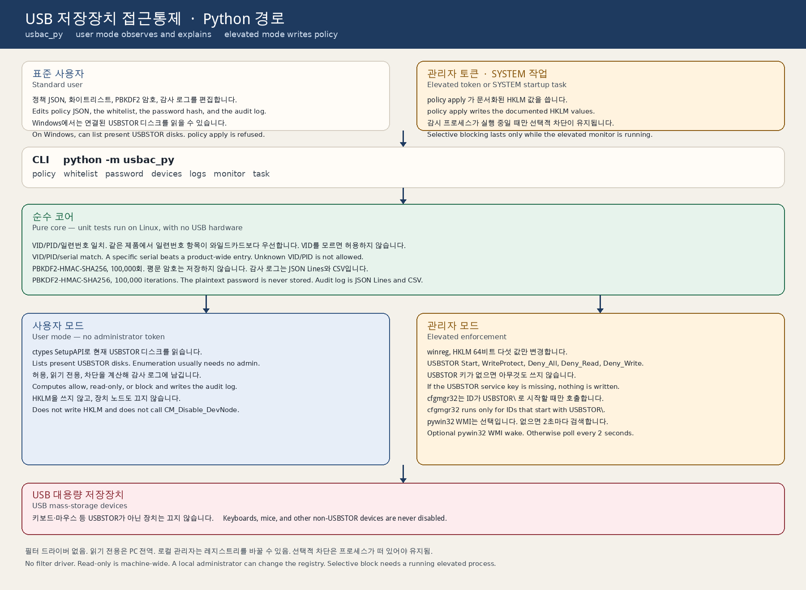

# USB 저장장치 접근통제 (Python)

Windows 10/11에서 USB 대용량 저장장치를 **허용**, **읽기 전용**, **차단**으로 두는 명령줄 도구입니다. 기존 .NET 앱과 같은 정책 모델의 Python 구현이며, .NET 솔루션은 바꾸지 않습니다. 저장소 라이선스는 루트의 [LICENSE](../LICENSE) (MIT, Copyright (c) 2026 kh20134) 하나입니다.

이 도구는 방어용 엔드포인트 정책입니다. 익스플로잇, 권한 상승, 다른 제품의 보호를 우회하는 코드는 들어 있지 않습니다.



## 사용자 모드와 관리자 모드

정직하게 나누면 아래와 같습니다. 사용자 모드 프로세스는 USB 저장을 실제로 막지 못합니다.

| 할 수 있는 일 | 표준 사용자 | 관리자 토큰 또는 SYSTEM 작업 |
| --- | --- | --- |
| `policy.json` 저장, 화이트리스트, PBKDF2 암호, 감사 로그 | 쓸 수 있는 폴더에서 가능 | 가능. 기본 폴더는 `%ProgramData%\UsbAccessControlPy` |
| 연결된 USBSTOR 디스크 목록 | Windows에서 보통 가능 (SetupAPI 읽기) | 가능 |
| 장치마다 허용 / 읽기 전용 / 차단 계산 | 가능. 적용은 하지 않음 | 가능 |
| HKLM 정책 값 쓰기 | 거부 | `policy apply` |
| USBSTOR 장치 노드 끄기/켜기 | 호출하지 않음 | `cfgmgr32`, 인스턴스 ID가 `USBSTOR\`로 시작할 때만 |
| 새로 꽂은 장치까지 계속 맞추기 | 불가 | `monitor` 또는 시작 작업이 떠 있는 동안 |

관리자 권한이 없으면 `policy apply`는 레지스트리를 건드리지 않고 종료 코드 4로 끝납니다. `monitor`는 관찰 모드로 동작하며, 결정을 감사 로그에 남기고 장치 노드는 바꾸지 않습니다.

전체 차단과 장치 노드 제어를 유지하려면 관리자로 연 PowerShell에서 실행하거나, `task install`로 로그온이 아닌 **시스템 시작** 때 **SYSTEM**이 `monitor`를 실행하게 합니다. Python에는 .NET 실행 파일처럼 관리자 매니페스트가 없으므로, 탐색기에서 `python.exe`를 두 번 눌러도 UAC가 뜨지 않습니다. 관리자 PowerShell을 직접 여십시오.

pywin32는 선택입니다. 있으면 WMI `Win32_DeviceChangeEvent`로 감시를 깨우고, 없거나 구독에 실패하면 2초마다 검색합니다. 열거와 레지스트리 적용은 pywin32 없이 ctypes와 표준 라이브러리 `winreg`로 합니다.

## 설치와 실행

필요 조건은 Windows 10/11과 Python 3.11 이상입니다. 정책 판단 테스트는 Linux에서도 돕니다.

```powershell
py -3.12 -m venv .venv
.\.venv\Scripts\Activate.ps1
pip install -e ".\python[windows]"
python -m usbac_py --help
```

`[windows]` 추가 기능은 pywin32입니다. WMI 깨우기가 필요 없으면 `pip install -e .\python` 만으로 됩니다. 제3자 런타임 의존성은 없습니다.

개발 PC에서 패키지를 설치하지 않고 보려면:

```bash
cd python
python -m usbac_py --help
python -m pytest
```

관리자 PowerShell에서 실제로 적용하는 예:

```powershell
python -m usbac_py policy show
python -m usbac_py policy set block
python -m usbac_py whitelist add --vid 0781 --pid 5581 --serial 4C530001230101123456 --name "SanDisk Ultra" --note "총무팀 승인"
python -m usbac_py policy apply --yes
python -m usbac_py devices
python -m usbac_py monitor
python -m usbac_py task install
```

차단을 실제 적용할 때만 `--yes`가 필요합니다. `policy apply --dry-run`은 레지스트리와 장치 노드를 바꾸지 않고, 쓰게 될 HKLM 값만 보여 줍니다.

다른 폴더는 `--data-dir`입니다. 기본 폴더는 .NET 앱의 `%ProgramData%\UsbAccessControl`과 일부러 다릅니다. 두 프로그램이 한 파일을 동시에 적용하지 않게 하려는 것입니다. JSON 필드 이름, PBKDF2-HMAC-SHA256(10만 회, 솔트 16바이트, 해시 32바이트, 암호 UTF-8), 정책 지문 형식은 .NET `policy.json`과 같게 맞춰 두었습니다. 한 파일만 쓸 거면 관리자가 `--data-dir`로 같은 폴더를 지정할 수 있지만, 적용은 한쪽만 하십시오.

관리자 암호가 있으면 정책·화이트리스트·암호 변경과 실제 적용에 암호가 필요합니다. `--password` 또는 환경 변수 `USBAC_ADMIN_PASSWORD`를 씁니다. 프로세스 목록에 암호가 보이지 않게 하려면 환경 변수를 쓰십시오. 둘 다 없으면 입력을 숨기고 묻습니다. `policy show`, `whitelist list`, `devices`, `logs`, `--dry-run`은 암호가 없어도 됩니다.

종료 코드는 0 성공, 2 암호 거부, 3 사용법 또는 차단 확인 누락, 4 권한·운영 체제, 1 그 외 실패입니다.

## 명령

```text
usbac-py policy show [--json]
usbac-py policy set <block|readonly|allow>
usbac-py policy apply --yes [--dry-run]

usbac-py whitelist list [--json]
usbac-py whitelist add --vid 0781 --pid 5581 [--serial 일련번호] --name 이름 [--note 메모]
usbac-py whitelist remove --id <guid>

usbac-py devices [--json]
usbac-py logs [--limit 20] [--json]
usbac-py logs export --out audit.csv
usbac-py password set --new <8자 이상>
usbac-py password clear
usbac-py monitor [--once] [--observe]
usbac-py task install
usbac-py task uninstall
```

`monitor --observe`는 관리자여도 장치 노드를 바꾸지 않습니다. `monitor --once`는 한 번만 검색하고 끝납니다. `task install`은 작업 이름 `UsbAccessControlPyMonitor`를 등록합니다. .NET 작업 `UsbAccessControlMonitor`는 건드리지 않습니다. SYSTEM이 사용자 프로필 안의 venv를 보지 못할 수 있으므로, 작업에 넣는 `python.exe`는 컴퓨터 전체 경로가 안전합니다. 경로에 `AppData` 또는 `venv`가 있으면 경고만 내고 등록은 계속합니다.

## 정책

화이트리스트와 맞지 않는 장치는 기본 정책을 따릅니다. 맞는 장치의 의도된 접근은 허용입니다. Windows가 그 의도를 그대로 적용할 수 있는지는 모드마다 다릅니다. 이 표는 .NET 구현과 같습니다.

| 모드 | 화이트리스트 | 실제 적용 |
| --- | --- | --- |
| 허용 | 있음/없음 | USBSTOR를 수동 시작(3)으로 두고 거부 값과 WriteProtect를 0으로 둡니다. 화이트리스트는 접근을 더 제한하지 않습니다. |
| 읽기 전용 | 있음/없음 | 이동식 디스크는 읽을 수 있고 쓰기는 거부됩니다. 쓰기 금지는 PC 전역이라 승인 장치도 쓸 수 없습니다. |
| 차단 | 없음 | USBSTOR를 사용 안 함(4)으로 두고 `Deny_All`과 이동식 디스크 읽기/쓰기를 거부합니다. |
| 차단 | 있음 | 전역 거부를 켜면 승인 장치까지 막히므로 레지스트리 거부는 끕니다. 일치하지 않는 USBSTOR 장치 노드만 비활성화합니다. VID/PID를 읽지 못한 저장장치는 허용하지 않습니다. |

적용하는 값은 모두 HKLM이고 64비트 보기입니다.

| 키 | 값 | 의미 |
| --- | --- | --- |
| `SYSTEM\CurrentControlSet\Services\USBSTOR` | `Start` | 3 수동 시작, 4 사용 안 함. 키가 없으면 아무것도 쓰지 않습니다. |
| `SYSTEM\CurrentControlSet\Control\StorageDevicePolicies` | `WriteProtect` | 1이면 쓰기 금지. 읽기 전용의 보조 수단입니다. |
| `SOFTWARE\Policies\Microsoft\Windows\RemovableStorageDevices` | `Deny_All` | 1이면 이동식 저장 클래스 전체를 거부합니다. |
| `...\RemovableStorageDevices\{53f5630d-b6bf-11d0-94f2-00a0c91efb8b}` | `Deny_Read`, `Deny_Write` | 이동식 디스크 클래스입니다. |

이 다섯 값 외의 레지스트리 경로는 쓰지 않습니다. 장치 노드를 끄는 경로도 `USBSTOR\`로 시작하는 인스턴스만 통과합니다.

일련번호 비교는 대소문자를 구분하지 않습니다. Windows가 붙이는 `&0` 같은 접미사는 비교 전에 뺍니다. 일련번호를 비우면 그 VID/PID 제품 전체를 승인합니다.

데이터 폴더의 파일은 다음과 같습니다.

| 파일 | 내용 |
| --- | --- |
| `policy.json` | 모드, 화이트리스트, 암호 해시, 마지막 적용 지문 |
| `audit.jsonl` | 감사 로그. 한 줄에 JSON 하나 |
| `enforcement-state.json` | 이 프로그램이 꺼 둔 USBSTOR 인스턴스 ID |

예시 파일은 [examples/policy.example.json](examples/policy.example.json)입니다. 암호는 들어 있지 않습니다. CSV 내보내기는 UTF-8 BOM이며, `=`, `+`, `-`, `@`로 시작하는 칸은 수식 실행을 피하도록 작은따옴표를 붙입니다.

관리자로 실행하고 데이터 폴더가 기본 ProgramData 경로일 때만, `icacls`로 그 폴더의 상속을 끄고 Administrators와 SYSTEM만 남기려 합니다. 실패해도 정책 저장은 계속됩니다. 이 ACL은 로컬 관리자를 막지 못합니다. 다른 `--data-dir`에는 ACL을 걸지 않습니다.

## 한계

- **로컬 관리자 우회.** 관리자는 레지스트리, 장치 관리자, 정책 파일을 직접 바꿀 수 있습니다. 관리자 암호는 이 프로그램의 변경 명령에 대한 추가 문이며, 운영 체제 권한을 대신하지 않습니다.
- **필터 드라이버가 없습니다.** 프로세스 종료, USBSTOR 시작 값 복구, 이미 열린 핸들로의 쓰기를 막지 못합니다.
- **그룹 정책과 경합합니다.** 도메인 GPO가 같은 키를 관리하면 로컬 값이 되돌아갈 수 있습니다.
- **선택적 차단은 프로세스가 있어야 합니다.** 감시가 없으면 새로 꽂은 장치가 열릴 수 있습니다. 승인 예외가 있을 때 전역 차단을 켜면 승인 장치까지 막히므로 그 조합은 쓰지 않습니다.
- **읽기 전용은 전역입니다.** 승인 장치만 쓰게 하려면 기본 정책을 차단으로 두고 화이트리스트를 쓰십시오.
- **WriteProtect의 빈틈.** UASP 장치에는 적용되지 않는 경우가 있습니다. 읽기 전용의 기본 수단은 이동식 디스크 `Deny_Write`입니다. MTP/PTP 휴대폰은 USBSTOR 디스크가 아니면 선택적 차단 대상이 아닙니다.
- **이미 마운트된 볼륨**은 다시 꽂거나 다시 로그온하기 전까지 이전 상태로 남을 수 있습니다.
- **감사 로그**는 로컬 파일이며 일련번호가 들어 있습니다. 중앙 수집이나 위변조 방지는 하지 않습니다.
- **기본 모드는 차단이지만 자동 적용하지 않습니다.** 처음 실행만으로 USB가 막히지는 않습니다.

## 테스트

Windows 장치나 관리자 권한 없이 정책 일치, 설정 파일 읽기/쓰기, 암호, 감사 로그, 적용 계획을 검사합니다. 테스트는 레지스트리를 쓰지 않습니다.

```bash
cd python
python -m pip install pytest
python -m pytest
```

---

# USB storage access control (Python)

Command-line tool that sets USB mass-storage access on Windows 10/11 to **allow**, **read-only**, or **block**. It is a Python implementation of the same policy model as the .NET app in this repository. The .NET solution is unchanged. The license is the repository [LICENSE](../LICENSE) (MIT, Copyright (c) 2026 kh20134).

This is a defensive endpoint policy tool. It does not contain exploit code, privilege escalation, or steps to bypass another product's protection.

## User mode and administrator mode

A standard user process cannot actually block USB storage. The split is:

| Capability | Standard user | Elevated token or SYSTEM task |
| --- | --- | --- |
| Save `policy.json`, whitelist, PBKDF2 password, audit log | Yes, in a folder the user can write | Yes. Default folder is `%ProgramData%\UsbAccessControlPy` |
| List connected USBSTOR disks | Usually yes on Windows (SetupAPI read) | Yes |
| Decide allow / read-only / block per device | Yes. This does not enforce it | Yes |
| Write HKLM policy values | Refused | `policy apply` |
| Enable or disable a USBSTOR device node | Not called | `cfgmgr32`, and only when the instance ID starts with `USBSTOR\` |
| Keep enforcing devices that are plugged in later | No | Only while `monitor` or the startup task is running |

Without an elevated token, `policy apply` changes nothing and exits with code 4. `monitor` runs in observe mode: it records the decision and does not change device nodes.

Full blocking and device-node control have to run from an elevated PowerShell, or from `task install`, which registers an **ONSTART** task as **SYSTEM**. Unlike the .NET executable, `python.exe` has no manifest that requests administrator rights, so launching it from Explorer does not show UAC. Open an elevated PowerShell yourself.

pywin32 is optional. When it is installed, a WMI `Win32_DeviceChangeEvent` subscription wakes the monitor. When it is missing, or the subscription fails, the monitor polls every two seconds. Enumeration and registry writes use ctypes and the standard-library `winreg` module and do not need pywin32.

## Install and run

Requires Windows 10/11 and Python 3.11 or newer. The policy tests also run on Linux.

```powershell
py -3.12 -m venv .venv
.\.venv\Scripts\Activate.ps1
pip install -e ".\python[windows]"
python -m usbac_py --help
```

The `[windows]` extra is pywin32. Skip it with `pip install -e .\python` if you do not want the WMI wake. There are no required third-party runtime dependencies.

From a checkout, without installing the package:

```bash
cd python
python -m usbac_py --help
python -m pytest
```

Apply a policy from an elevated PowerShell:

```powershell
python -m usbac_py policy show
python -m usbac_py policy set block
python -m usbac_py whitelist add --vid 0781 --pid 5581 --serial 4C530001230101123456 --name "SanDisk Ultra" --note "approved"
python -m usbac_py policy apply --yes
python -m usbac_py devices
python -m usbac_py monitor
python -m usbac_py task install
```

`--yes` is required only for a real block apply. `policy apply --dry-run` prints the HKLM values that would be written and does not change the registry or device nodes.

`--data-dir` selects another folder. The default is intentionally different from the .NET app's `%ProgramData%\UsbAccessControl`, so the two programs do not apply one file at the same time. Field names, PBKDF2-HMAC-SHA256 (100,000 iterations, 16-byte salt, 32-byte hash, UTF-8 password), and the policy fingerprint match the .NET `policy.json`. An administrator can point `--data-dir` at one shared folder, but only one program should apply it.

When an admin password is set, changing policy, the whitelist, or the password, and a real apply, require it. Pass `--password` or the environment variable `USBAC_ADMIN_PASSWORD`. Prefer the environment variable so the password does not appear in the process list. If neither is set, the CLI prompts with hidden input. `policy show`, `whitelist list`, `devices`, `logs`, and `--dry-run` do not require the password.

Exit codes: 0 success, 2 password rejected, 3 usage or missing block confirmation, 4 privilege or operating system, 1 any other failure.

## Commands

```text
usbac-py policy show [--json]
usbac-py policy set <block|readonly|allow>
usbac-py policy apply --yes [--dry-run]

usbac-py whitelist list [--json]
usbac-py whitelist add --vid 0781 --pid 5581 [--serial SERIAL] --name NAME [--note NOTE]
usbac-py whitelist remove --id <guid>

usbac-py devices [--json]
usbac-py logs [--limit 20] [--json]
usbac-py logs export --out audit.csv
usbac-py password set --new <at least 8 characters>
usbac-py password clear
usbac-py monitor [--once] [--observe]
usbac-py task install
usbac-py task uninstall
```

`monitor --observe` does not change device nodes even for an administrator. `monitor --once` scans once and exits. `task install` registers `UsbAccessControlPyMonitor`. It does not change the .NET task `UsbAccessControlMonitor`. SYSTEM may not be able to see a virtualenv under a user profile, so prefer a machine-wide `python.exe`. If the path contains `AppData` or `venv`, the command warns and still registers that path.

## Policy

Devices that do not match the whitelist follow the default mode. A match is intended to be allowed. Whether Windows can express that intent depends on the mode. This table matches the .NET implementation.

| Mode | Whitelist | What is enforced |
| --- | --- | --- |
| Allow | present or not | USBSTOR demand start (3). Deny values and WriteProtect are 0. The whitelist does not add restrictions. |
| Read-only | present or not | Removable disks can be read and writes are denied. The write deny is machine-wide, so an approved device cannot write either. |
| Block | absent | USBSTOR disabled (4), plus `Deny_All` and removable-disk read/write deny. |
| Block | present | A global deny would also block approved devices, so the registry denies stay off. Only non-matching USBSTOR device nodes are disabled. A storage device with no readable VID/PID is not allowed. |

Every applied value is under HKLM, opened with the 64-bit registry view.

| Key | Value | Meaning |
| --- | --- | --- |
| `SYSTEM\CurrentControlSet\Services\USBSTOR` | `Start` | 3 demand start, 4 disabled. If the key is missing, nothing is written. |
| `SYSTEM\CurrentControlSet\Control\StorageDevicePolicies` | `WriteProtect` | 1 denies writes. Secondary control for read-only mode. |
| `SOFTWARE\Policies\Microsoft\Windows\RemovableStorageDevices` | `Deny_All` | 1 denies every removable storage class. |
| `...\RemovableStorageDevices\{53f5630d-b6bf-11d0-94f2-00a0c91efb8b}` | `Deny_Read`, `Deny_Write` | Removable disk class. |

No other registry path is written. Device-node changes are refused unless the instance ID starts with `USBSTOR\`.

Serial comparison is case-insensitive. A Windows suffix such as `&0` is removed before comparison. An empty serial approves every device with that VID/PID.

Files in the data directory:

| File | Contents |
| --- | --- |
| `policy.json` | Mode, whitelist, password hash, last applied fingerprint |
| `audit.jsonl` | Audit log, one JSON object per line |
| `enforcement-state.json` | USBSTOR instance IDs this program disabled |

[examples/policy.example.json](examples/policy.example.json) is a sample with no password. CSV export uses a UTF-8 BOM, and cells that start with `=`, `+`, `-`, or `@` are prefixed with a quote so a spreadsheet does not treat them as formulas.

Only when the process is elevated and the data directory is the default ProgramData folder does the tool try `icacls` to drop inheritance and leave Administrators and SYSTEM. A failure does not roll back the saved policy. That ACL does not stop a local administrator. Other `--data-dir` values are left alone.

## Limits

- **Local administrators can undo it.** They can edit the registry, Device Manager, and the policy file. The admin password only gates this program's commands. It is not an operating-system privilege boundary.
- **There is no filter driver.** Stopping the process, setting USBSTOR back to start, or writing through a handle that is already open is outside what these registry values and device-node calls can do.
- **Group Policy can win.** A domain GPO that owns the same keys can restore them.
- **Selective block needs a running process.** Without the monitor, a newly inserted device can come online. A global deny is not used together with an allow-list, because that would block the approved devices too.
- **Read-only is global.** To let only approved devices write, set the default mode to block and use the whitelist.
- **WriteProtect has gaps.** It often does not apply to UASP devices. The primary read-only control is removable-disk `Deny_Write`. Phones that attach as MTP/PTP are not USBSTOR disks, so selective block does not see them.
- **Volumes that are already mounted** can keep their previous access until the device is reconnected or the user signs in again.
- **The audit log is a local file** and contains serial numbers. It is not centrally collected or tamper-evident.
- **The default mode is block, and it is not applied automatically.** The first run does not disable USB storage. Someone has to apply it.

## Tests

Policy matching, config load/save, the password hash, the audit log, and the enforcement plan are tested without Windows hardware and without administrator rights. The tests do not write the registry.

```bash
cd python
python -m pip install pytest
python -m pytest
```
